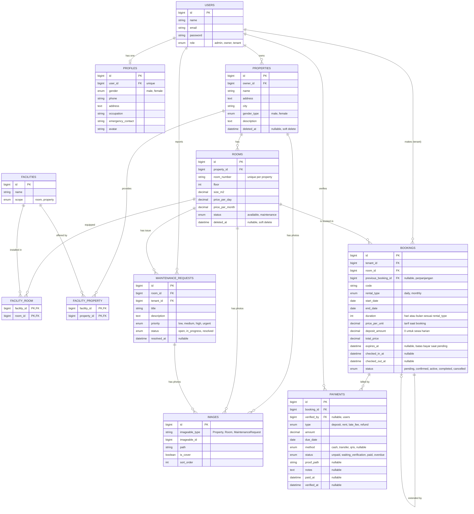

# Kost Area — Platform Manajemen dan Booking Kos

Kost Area adalah aplikasi web manajemen dan booking kos yang dibangun dengan **Laravel**, **Blade**, dan **Tailwind CSS**. Proyek ini merupakan tugas mata kuliah **PBO2**, dengan fokus pada perancangan dan implementasi **relasi antar tabel database** menggunakan Eloquent ORM. Studi kasusnya: satu pemilik mengelola dua kos, **Kost Area Putra** dan **Kost Area Putri**.

## Fitur

- Pemilik dapat mendaftarkan lebih dari satu kos (properti), masing-masing dengan kamarnya sendiri
- Kos khusus putra atau khusus putri (tidak ada kos campur), dan penghuni hanya dapat memesan kos yang sesuai jenis kelaminnya
- Kamar dengan data lantai, ukuran, harga sewa harian, harga sewa bulanan, dan status operasional:
  Aktif (Available) atau Perbaikan (Maintenance)
- Ketersediaan kamar dihitung dari tanggal booking, bukan dari satu kolom status
- Fasilitas kamar (AC, kamar mandi dalam, Wi-Fi, kasur) dan fasilitas kos (parkir, dapur bersama, laundry, CCTV) yang dipakai bersama melalui daftar fasilitas
- Foto untuk kos, kamar, dan laporan kerusakan
- Booking kamar dengan sewa harian atau bulanan; harga saat booking disimpan sehingga perubahan harga tidak memengaruhi booking lama
- Booking `pending` yang tidak dibayar dalam batas waktu otomatis dibatalkan
- Perpanjangan sewa, check-in, dan check-out aktual
- Penagihan otomatis: sewa bulanan ditagih dengan deposit dan satu pembayaran sewa per bulan; sewa harian ditagih satu kali tanpa deposit
- Pembayaran tunai, transfer bank, atau QRIS dengan unggah bukti bayar dan verifikasi pemilik; status:
  Belum Dibayar (Unpaid), Menunggu Verifikasi (Waiting Verification), Lunas (Paid), dan Terlambat (Overdue)
- Denda keterlambatan dan pengembalian deposit (penuh atau dipotong) dicatat sebagai pembayaran tersendiri
- Laporan kerusakan dari penghuni (AC rusak, pipa bocor) lengkap dengan prioritas, foto, dan status penanganannya
- Profil penghuni berisi jenis kelamin, nomor telepon, pekerjaan, dan kontak darurat
- Akses berbasis peran: `admin` mengelola seluruh platform, `owner` mengelola properti dan kamar miliknya, `tenant` melakukan booking kamar dan melaporkan masalah

## Desain Database

Skema lengkap dan seluruh relasi didokumentasikan dengan diagram Mermaid di
[`docs/database/erd.md`](docs/database/erd.md).



### Relasi yang Dicakup

| Jenis | Contoh |
|---|---|
| One-to-One | `User` ↔ `Profile` |
| One-to-Many | `User` (owner) → `Property`, `Property` → `Room`, `Room` → `Booking`, `Booking` → `Payment`, `Room` → `MaintenanceRequest`, `User` (tenant) → `MaintenanceRequest`, `User` (verifikator) → `Payment` |
| Many-to-Many | `Room` ↔ `Facility` (`facility_room`), `Property` ↔ `Facility` (`facility_property`) |
| Many-to-Many dengan data pivot | `User` (tenant) ↔ `Room` melalui `bookings` (`rental_type`, `start_date`, `end_date`, `duration`, `price_per_unit`, `deposit_amount`, `status`) |
| Has-Many-Through | `Property` → `Booking` melalui `Room`, `User` (owner) → `Room` melalui `Property` |
| Polymorphic One-to-Many | `Image` milik `Property`, `Room`, atau `MaintenanceRequest` (`imageable_type`, `imageable_id`) |
| Self-referencing | `Booking` → `Booking` lewat `previous_booking_id` (perpanjangan sewa) |

### Aturan Bisnis

- Jenis kos (`properties.gender_type`) hanya `male` atau `female`, dan `room_number` unik dalam satu kos.
- Penghuni wajib melengkapi profil sebelum booking, dan hanya boleh memesan kamar di kos yang `gender_type`-nya sama dengan `profiles.gender` miliknya.
- `rooms.status` hanya `available` atau `maintenance`. Kamar dianggap kosong pada suatu tanggal jika `available` dan tidak ada booking aktif (`pending`, `confirmed`, `active`) yang periodenya beririsan.
- Sebuah kamar hanya boleh memiliki satu booking aktif pada periode waktu yang sama.
- `bookings.rental_type` adalah `daily` atau `monthly`; `duration` dihitung dalam hari untuk `daily` dan bulan untuk `monthly`.
- Saat booking dibuat, tarif kamar disalin ke `bookings.price_per_unit`, lalu `total_price` = `price_per_unit` × `duration` dan `end_date` = `start_date` + `duration` (hari atau bulan).
- Sewa bulanan: sistem membuat satu pembayaran `deposit` dan satu pembayaran `rent` per bulan, masing-masing dengan `due_date` sendiri.
- Sewa harian: tanpa deposit; sistem membuat satu pembayaran `rent` senilai `total_price` yang jatuh tempo pada `start_date`.
- Untuk transfer dan QRIS, penghuni mengunggah bukti bayar sehingga status menjadi `waiting_verification`; setelah diverifikasi pemilik, status menjadi `paid`. Pembayaran tunai dapat langsung dicatat `paid` oleh pemilik.
- Pembayaran berubah menjadi `overdue` jika masih `unpaid` setelah melewati `due_date`. Denda keterlambatan (opsional, besarnya dari konfigurasi) dicatat sebagai pembayaran `late_fee`.
- Booking `pending` otomatis menjadi `cancelled` jika tidak dibayar sebelum `expires_at` (misalnya 24 jam setelah dibuat).
- Booking menjadi `active` saat check-in dan `completed` saat check-out. Perpanjangan dibuat sebagai booking baru dengan `previous_booking_id` menunjuk booking sebelumnya.
- Setelah booking `completed`, deposit dikembalikan lewat pembayaran `refund`; jika dipotong, alasannya dicatat di `payments.notes`.
- Penghuni hanya dapat membuat laporan kerusakan untuk kamar yang sedang ia sewa.
- Pemilik hanya dapat mengelola properti dan kamar yang ia miliki. Properti dan kamar memakai *soft delete* agar riwayat booking dan pembayaran tetap utuh.

## Teknologi yang Digunakan

- PHP 8.3+ dan Laravel
- Template Blade
- Tailwind CSS (melalui Vite)
- MySQL atau SQLite

## Memulai

```bash
# Clone repository
git clone http://github.com/Luchyana-Desi/laravel5d
cd laravel5d

# Install dependensi
composer install
npm install

# Atur environment
cp .env.example .env
php artisan key:generate

# Buat skema database dan isi data fasilitas serta dua kos contoh (putra & putri)
php artisan migrate --seed

# Jalankan server pengembangan
npm run dev
php artisan serve

# (Opsional) Jalankan scheduler untuk pembatalan otomatis dan penandaan pembayaran terlambat
php artisan schedule:work
```

Lalu buka <http://localhost:8000>.

## Struktur Proyek

```
app/Models/        Model Eloquent dan relasinya
database/
  migrations/      Definisi tabel
  factories/       Pembuat data palsu
  seeders/         Data fasilitas, kos putra & putri, dan data contoh
resources/views/   Template Blade
docs/
  database/        Dokumentasi ERD dan relasi
```

## Roadmap

- [x] Desain dan dokumentasi database
- [ ] Migration, model, factory, dan seeder
- [ ] Autentikasi dan akses berbasis peran
- [ ] Pengelolaan properti, kamar, fasilitas, dan foto
- [ ] Booking kamar harian/bulanan dengan pengecekan jenis kelamin dan ketersediaan
- [ ] Penagihan otomatis, pembayaran, dan verifikasi bukti bayar
- [ ] Check-in, check-out, perpanjangan, dan pengembalian deposit
- [ ] Scheduler pembatalan booking dan penandaan pembayaran terlambat
- [ ] Laporan kerusakan

## Penulis

Luchyana Desi Safitri — NPM 2410010230

## Lisensi

Dirilis di bawah [Lisensi MIT](https://opensource.org/licenses/MIT).
