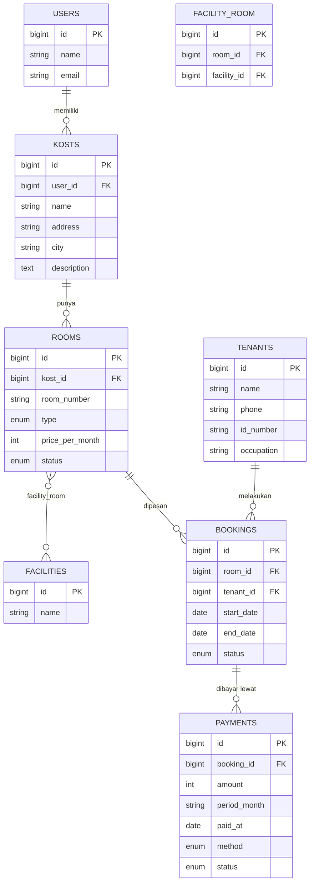

# Kost Area: Platform Manajemen dan Booking Kos

Kost Area adalah aplikasi web manajemen dan booking kos yang dibangun dengan **Laravel** dan **Blade**. Proyek ini merupakan tugas mata kuliah **PBO2**, dengan fokus pada perancangan dan implementasi **relasi antar tabel database** menggunakan Eloquent ORM.

## Fitur Database

- Pemilik (`users`) dapat memiliki lebih dari satu kost
- Setiap kost memiliki banyak kamar, dengan tipe `putra`, `putri`, atau `campur`
- Kamar memiliki harga sewa per bulan dan status `available`, `occupied`, atau `maintenance`
- Fasilitas dipakai bersama oleh banyak kamar (many-to-many lewat tabel `facility_room`)
- Penyewa (`tenants`) dapat melakukan booking kamar
- Booking memiliki tanggal mulai, tanggal selesai, dan status `pending`, `active`, `finished`, atau `cancelled`
- Setiap booking memiliki pembayaran per bulan dengan metode `cash`, `transfer`, atau `ewallet`

## Desain Database

Penjelasan relasi lengkap ada di [`docs/erd.md`](docs/erd.md).



### Relasi yang Dicakup

| Jenis | Contoh |
|---|---|
| One-to-Many | `User` → `Kost`, `Kost` → `Room`, `Room` → `Booking`, `Tenant` → `Booking`, `Booking` → `Payment` |
| Many-to-Many | `Room` ↔ `Facility` (tabel pivot `facility_room`) |

### Aturan Bisnis

- Satu pemilik dapat memiliki banyak kost, dan satu kost dapat memiliki banyak kamar.
- `room_number` unik di dalam satu kost.
- `rooms.type` bernilai `putra`, `putri`, atau `campur`. `rooms.status` bernilai `available`, `occupied`, atau `maintenance`.
- Satu kamar dapat dipesan berkali-kali pada periode berbeda, dan satu penyewa dapat memiliki banyak booking.
- `bookings.status` bernilai `pending`, `active`, `finished`, atau `cancelled`. `end_date` boleh kosong untuk sewa yang belum ditentukan akhirnya.
- Pembayaran dicatat per bulan memakai `payments.period_month` berformat `YYYY-MM`.
- `payments.status` bernilai `unpaid` atau `paid`. Kolom `paid_at` terisi saat pembayaran lunas.
- `tenants.id_number` dan `facilities.name` bersifat unik.
- Semua foreign key memakai `cascadeOnDelete`: menghapus induk ikut menghapus data turunannya.

## Teknologi yang Digunakan

- PHP 8.3+ dan Laravel
- Template Blade
- MySQL atau SQLite

## Memulai

```bash
# Clone repository
git clone https://github.com/Luchyana-Desi/laravel5d
cd laravel5d

# Install dependensi
composer install
npm install

# Atur environment
cp .env.example .env
php artisan key:generate

# Buat skema database dan isi data contoh
php artisan migrate:fresh --seed

# Jalankan server pengembangan
php artisan serve
```

Lalu buka <http://localhost:8000>.

Seeder (`KostAreaSeeder`) mengisi data contoh: 1 pemilik, 6 fasilitas, 2 kost, 10 kamar, 6 penyewa, 6 booking, dan 18 pembayaran.

## Struktur Proyek

```
app/Models/        Model Eloquent dan relasinya
database/
  migrations/      Definisi tabel
  factories/       Pembuat data contoh
  seeders/         KostAreaSeeder dan DatabaseSeeder
docs/
  erd.md           Dokumentasi ERD dan relasi
  progress/        Laporan progres per fase
```

## Roadmap

- [x] Desain dan dokumentasi database
- [x] Migration, model, factory, dan seeder
- [ ] CRUD dengan template AdminLTE (Assignment 2)
- [ ] Autentikasi dan akses berbasis peran
- [ ] Controller, route, dan tampilan Kost Area

## Penulis

Luchyana Desi Safitri, NPM 2410010230

## Lisensi

Dirilis di bawah [Lisensi MIT](https://opensource.org/licenses/MIT).