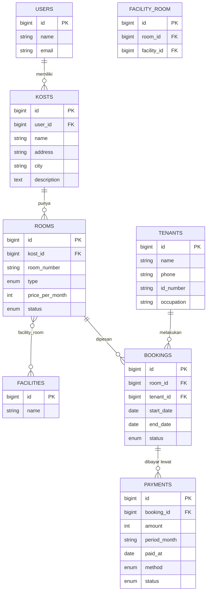

# ERD: Kost Area

Diagram relasi antar tabel (Mermaid; otomatis tampil di GitHub).

## Ringkasan relasi

| Tabel A | Relasi | Tabel B | Keterangan |
|---|---|---|---|
| users | one-to-many | kosts | satu pemilik bisa punya banyak kost |
| kosts | one-to-many | rooms | satu kost punya banyak kamar |
| rooms | many-to-many | facilities | pivot `facility_room` |
| rooms | one-to-many | bookings | satu kamar bisa dipesan berkali-kali (periode berbeda) |
| tenants | one-to-many | bookings | satu penyewa bisa punya banyak booking |
| bookings | one-to-many | payments | pembayaran bulanan per booking |

## Aturan integritas

- Semua foreign key memakai `cascadeOnDelete`.
- `rooms`: kombinasi `kost_id` + `room_number` unik.
- `facility_room`: kombinasi `room_id` + `facility_id` unik (tidak ada duplikat).
- `tenants.id_number` dan `facilities.name` unik.
