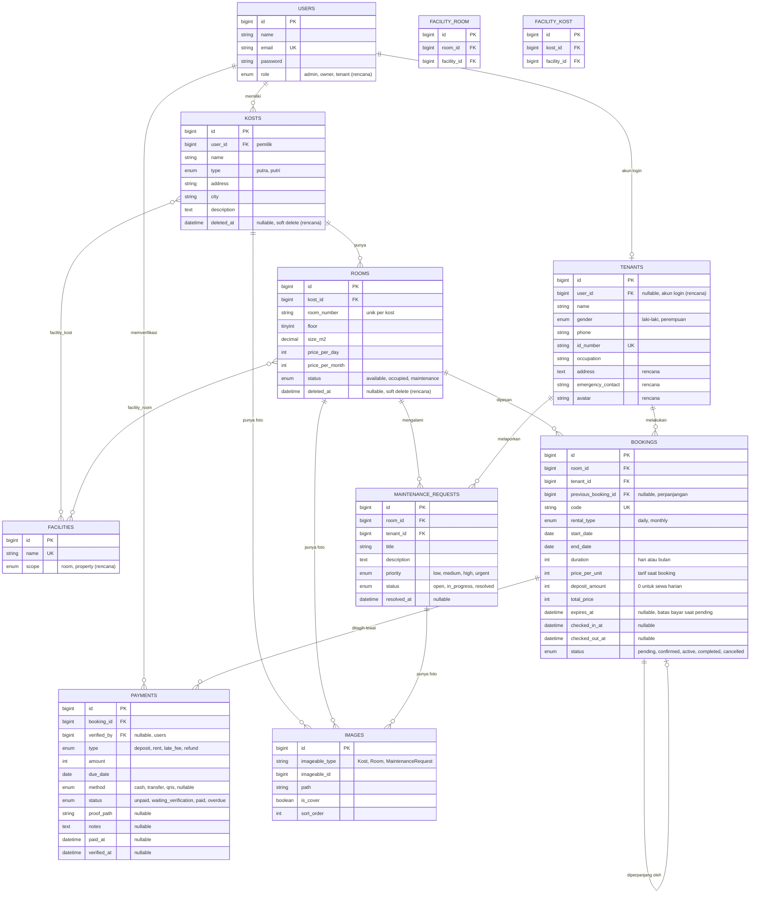

# ERD: Kost Area

Dokumen ini memuat rancangan database **lengkap** untuk Kost Area. Sebagian tabel sudah dibuat dan dijalankan (lihat tabel status di bawah), sisanya dikerjakan di tahap berikutnya.

## Diagram

Diagram Mermaid (otomatis tampil di GitHub).

## Status implementasi

| Tabel | Status | Catatan |
|---|---|---|
| `users` | Sudah dibuat | Kolom `role` masih rencana |
| `kosts` | Sudah dibuat | `deleted_at` (soft delete) masih rencana |
| `rooms` | Sudah dibuat | `deleted_at` (soft delete) masih rencana |
| `facilities` | Sudah dibuat | Kolom `scope` masih rencana |
| `facility_room` | Sudah dibuat | |
| `tenants` | Sudah dibuat | `user_id`, `address`, `emergency_contact`, `avatar` masih rencana |
| `bookings` | Sudah dibuat | Lengkap |
| `payments` | Sudah dibuat | Lengkap |
| `facility_kost` | Rencana | Fasilitas milik kost (parkir, dapur bersama, laundry, CCTV) |
| `images` | Rencana | Foto kost, kamar, dan laporan kerusakan |
| `maintenance_requests` | Rencana | Laporan kerusakan dari penghuni |

## Ringkasan relasi

| Tabel A | Relasi | Tabel B | Keterangan |
|---|---|---|---|
| users | one-to-many | kosts | satu pemilik punya banyak kost (`kosts.user_id`) |
| users | one-to-one | tenants | akun login penghuni (`tenants.user_id`, rencana) |
| users | one-to-many | payments | pemilik yang memverifikasi (`payments.verified_by`) |
| kosts | one-to-many | rooms | satu kost punya banyak kamar (`rooms.kost_id`) |
| rooms | many-to-many | facilities | pivot `facility_room` |
| kosts | many-to-many | facilities | pivot `facility_kost` (rencana) |
| kosts, rooms, maintenance_requests | polymorphic one-to-many | images | `imageable_type` + `imageable_id` (rencana) |
| rooms | one-to-many | bookings | satu kamar dipesan berkali-kali pada periode berbeda |
| tenants | one-to-many | bookings | satu penyewa punya banyak booking |
| bookings | self-reference | bookings | perpanjangan lewat `previous_booking_id` |
| bookings | one-to-many | payments | deposit, sewa per bulan, denda, dan pengembalian deposit |
| rooms | one-to-many | maintenance_requests | kamar yang mengalami masalah (rencana) |
| tenants | one-to-many | maintenance_requests | penghuni yang melapor (rencana) |

## Jenis relasi yang dicakup

| Jenis | Contoh |
|---|---|
| One-to-One | `User` ↔ `Tenant` (rencana) |
| One-to-Many | `User` → `Kost`, `Kost` → `Room`, `Room` → `Booking`, `Tenant` → `Booking`, `Booking` → `Payment`, `Room` → `MaintenanceRequest` |
| Many-to-Many | `Room` ↔ `Facility`, `Kost` ↔ `Facility` (rencana) |
| Many-to-Many dengan data pivot | `Tenant` ↔ `Room` melalui `bookings` (jenis sewa, tanggal, durasi, tarif, deposit, status) |
| Has-Many-Through | `Kost` → `Booking` melalui `Room`, `User` (pemilik) → `Room` melalui `Kost` |
| Polymorphic One-to-Many | `Image` milik `Kost`, `Room`, atau `MaintenanceRequest` (rencana) |
| Self-referencing | `Booking` → `Booking` lewat `previous_booking_id` |

## Nilai kolom enum

| Kolom | Nilai |
|---|---|
| `users.role` | `admin`, `owner`, `tenant` |
| `kosts.type` | `putra`, `putri` |
| `tenants.gender` | `laki-laki`, `perempuan` |
| `rooms.status` | `available`, `occupied`, `maintenance` |
| `facilities.scope` | `room`, `property` |
| `bookings.rental_type` | `daily`, `monthly` |
| `bookings.status` | `pending`, `confirmed`, `active`, `completed`, `cancelled` |
| `payments.type` | `deposit`, `rent`, `late_fee`, `refund` |
| `payments.method` | `cash`, `transfer`, `qris` |
| `payments.status` | `unpaid`, `waiting_verification`, `paid`, `overdue` |
| `maintenance_requests.priority` | `low`, `medium`, `high`, `urgent` |
| `maintenance_requests.status` | `open`, `in_progress`, `resolved` |

## Aturan integritas

- Semua foreign key memakai `cascadeOnDelete`, kecuali `bookings.previous_booking_id` dan `payments.verified_by` yang menjadi `null` saat induknya dihapus.
- `rooms`: kombinasi `kost_id` + `room_number` unik.
- `facility_room` dan `facility_kost`: kombinasi pasangan id unik (tidak ada duplikat).
- `bookings.code`, `tenants.id_number`, dan `facilities.name` unik.
- Tarif pada `bookings.price_per_unit` disalin saat booking dibuat, sehingga perubahan harga kamar tidak memengaruhi booking lama.
- Kost dan kamar akan memakai *soft delete* agar riwayat booking dan pembayaran tetap utuh (rencana).